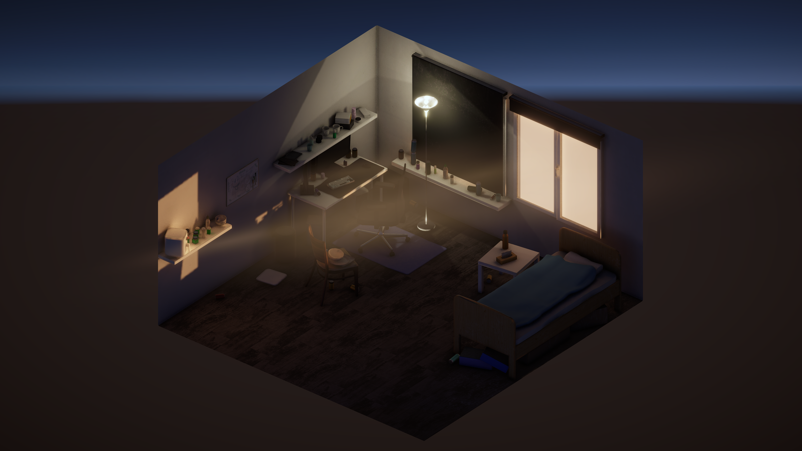
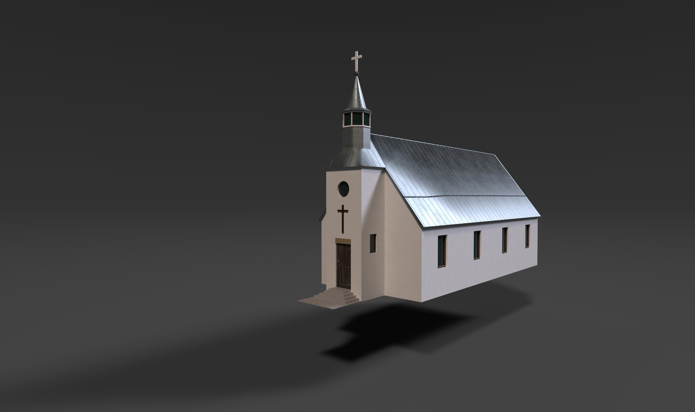

# Maya 3D Modelling Portfolio

Maya coursework and final project files from the Art Fundamentals module, also includes church game asset. All of this was created during the [Beginning Serious Game Design minor](https://www.saxion.nl/opleidingen/en/minoren/b/beginning-serious-game-design) at Saxion University of Applied Sciences.

## Messy Room

*My Messy Room — final project for the Maya / Art module.*

The final assignment was to create a room. I chose a messy bedroom based on my actual room, with furniture and everyday clutter that make the space feel lived in. Warm light enters through the window.

[Maya scene](MessyRoom/FinishedFiles/MartinsDavisBernhards_552135_Maya.ma) · [Unity package](MessyRoom/FinishedFiles/MartinsDavisBernhards_552135_Package.unitypackage)

### Modelling and texturing

- **Autodesk Maya:** 3D modelling, arranging the room and props, and UV mapping.
- **Substance Painter:** Texturing, with exported albedo/transparency, normal, metallic/smoothness and emission maps across ten material groups.
- **Unity delivery:** A Unity package included with the final submission, alongside the Maya scene and texture files.

## Catholic Church — Impact Event

I also created a Catholic Church asset for [**Impact Event**](https://github.com/mdbernhards/ImpactEvent), a game made for another Unity module in the same minor. The image above is a render from Substance Painter.

[Maya scene](Church/CatholicChurchLiepajas13.mb)

## Structure
| Folder | Contents |
| --- | --- |
| [MessyRoom/](MessyRoom/) | Final room submission, working scenes, exports, textures, renders and backup |
| [Church/](Church/) | Church scene, renders and archived older version |
| [Other/](Other/) | Bootcamp exercises and other modelling scenes |
